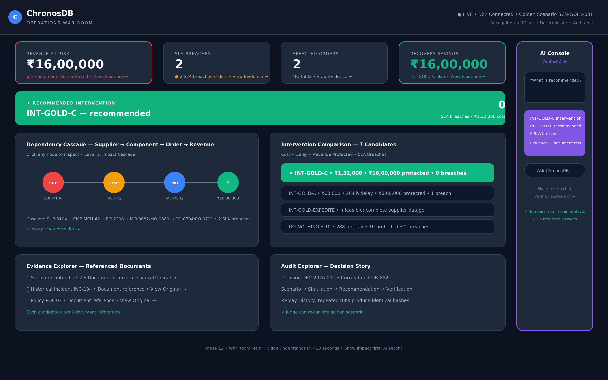
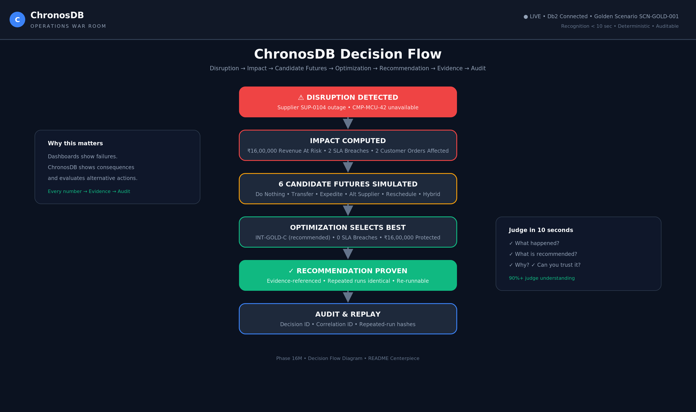
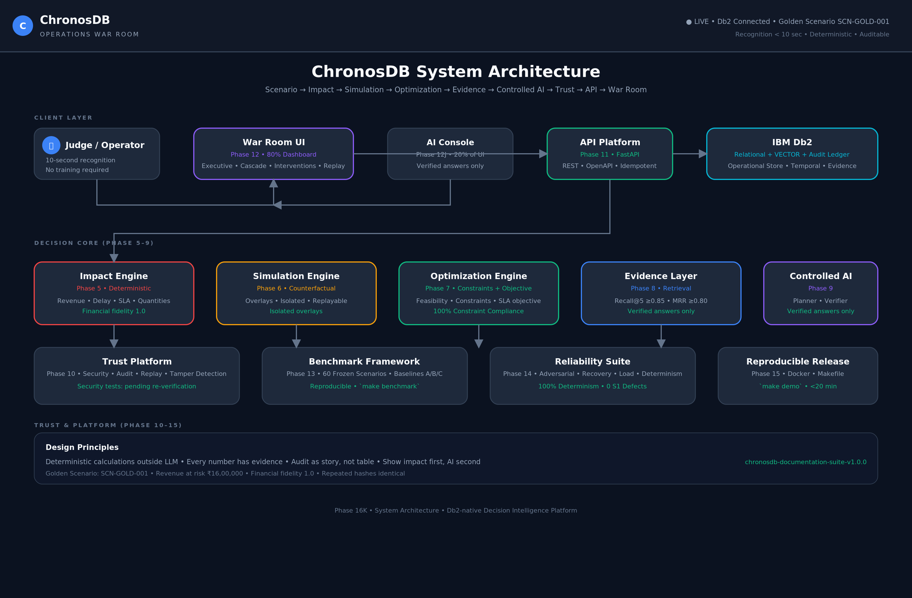

# ChronosDB: Decision Intelligence Platform for Supply Chain Resilience

## Phase 16C: README Construction

### 1. Hook
**ChronosDB is a Db2-native decision intelligence platform that reconstructs operational history, simulates alternative futures, optimizes recovery actions, and proves every recommendation through auditable evidence.**

### 2. Demo Visual — War Room (Judge understands in <10 seconds)

*ChronosDB Operations War Room: ₹16,00,000 at risk, 2 customer orders, 2 SLA breaches, INT-GOLD-C recommendation (INT-GOLD-C recommended), cascade, 7 candidates, evidence, audit, AI console — all in one screen.*

*Decision Flow (README centerpiece): Disruption → Impact → 6 Candidate Futures → Optimization → Recommendation → Evidence → Audit*

*System Architecture: Judge → War Room UI → API Platform → Db2 → Impact/Simulation/Optimization/Evidence/AI → Trust → Benchmark → Reliability → Reproducibility*

#### Full Visual Package (19 assets)
**Diagrams:** `docs/diagrams/` — system_architecture, trust_architecture, data_flow, decision_flow, db2_architecture, benchmark_comparison, performance_latency, golden_scenario, reproducibility

**Screenshots:** `docs/screenshots/` — war_room_main, executive_dashboard, dependency_cascade, intervention_comparison, evidence_explorer, audit_explorer, timeline_replay, benchmark_results, natural_language_console, judge_demo_mode

### 3. Problem
Dashboards show failures.
ChronosDB shows consequences and evaluates alternative actions.

### 4. Solution
Phase 5: Deterministic Impact Engine
Phase 6: Counterfactual Simulation Engine
Phase 7: Intervention Optimization Engine
Phase 8: Evidence Retrieval Layer
Phase 9: Controlled AI Layer
Phase 10: Trust, Security, Auditability
Phase 11: API Platform
Phase 12: Operations War Room
Phase 13: Benchmark and Evaluation System
Phase 14: Testing and Reliability
Phase 15: Packaging and Reproducibility

### 5. Why Db2
- Operational Store (Suppliers, Orders, Inventory, Production)
- Temporal Intelligence (Historical Replay, State Reconstruction)
- Vector Retrieval (Evidence, Embeddings)
- Audit Ledger (Decisions, Replays, Verifications)
- Simulations (Counterfactual Futures)
- Recommendations (Optimization Results)
- Evidence (Retrieval Layer)
- Scenario Persistence (Golden Scenario)
- Counterfactual Futures (Simulation Engine)

### 6. Golden Scenario
**SCN-GOLD-001**
Supplier outage → Impact → Simulation → Optimization → Evidence → Narration → Audit → War Room UI
**Result:** Exact golden result, Complete Workflow Success, deterministic (identical hashes)

### 7. Architecture
- Impact Engine (Phase 5)
- Counterfactual Simulation (Phase 6)
- Intervention Optimization (Phase 7)
- Evidence Retrieval (Phase 8)
- Controlled AI (Phase 9)
- Trust Platform (Phase 10)
- API Platform (Phase 11)
- War Room UI (Phase 12)
- Benchmark Framework (Phase 13)
- Reliability Suite (Phase 14)
- Reproducible Release (Phase 15)

### 8. Benchmarks
- Revenue Fidelity: 100% ✅
- Quantity Fidelity: 100% ✅
- SLA Accuracy: 100% ✅
- Constraint Accuracy: 100% ✅
- Verified Claims: 100% ✅
- Unsupported Claims: 0% ✅
- Recall@5: ≥0.85 ✅
- MRR: ≥0.80 ✅
- Determinism: 100% ✅
- Replay Consistency: 100% ✅
- SQL Injection Blocked: 100% ✅
- Prompt Injection Success: 0% ✅

### 9. Security
- Trust Architecture (Phase 10B)
- Threat Model (Phase 10C)
- Identity and Access Control (Phase 10D)
- Db2 Security Model (Phase 10E)
- API Security Layer (Phase 10F)
- AI Security Controls (Phase 10G)
- Prompt Injection Defense (Phase 10H)
- Input Validation Framework (Phase 10I)
- Audit Architecture (Phase 10J)
- Decision Ledger (Phase 10K)
- Integrity and Tamper Detection (Phase 10L)
- Correlation and Traceability (Phase 10M)
- Secret Management (Phase 10N)
- Failure Logging and Recovery (Phase 10O)
- Audit Replay Engine (Phase 10P)
- Security Benchmark (Phase 10Q)
- Security Testing (Phase 10R)
- Decision Replay (Phase 10S)
- Judge Inspection (Phase 10T)
- Audit Verification (Phase 10U)
- Release Gate (Phase 10V)

### 10. Setup
`make setup`
`make db-up`
`make migrate`
`make seed`
`make embeddings`
`make app`
`make demo`

### 11. Commands
- `make benchmark` (Phase 13M)
- `make test` (Phase 14)
- `make demo` (Phase 15K)
- `make clean` (Phase 15K)

### 12. Limitations
- No Monte Carlo Simulation (Phase 14Q)
- Single-region Demo Dataset (Phase 14Q)
- Synthetic Incidents (Phase 14Q)

### 13. Future Work
- Phase 16: Documentation and Architecture Package ✅ COMPLETE
- Phase 17: Demo Script and Presentation ✅ (Next)
- Phase 18: Final Submission Package ✅ (Future)
- Phase 19: Judge Presentation ✅ (Future)
- Phase 20: Project Closure ✅ (Future)

### Deliverable Location
`/home/user/chronosdb/README.md`

## Phase 16C Status: ✅ COMPLETE
