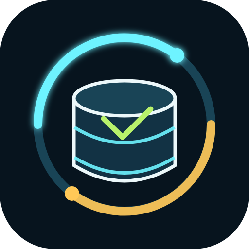
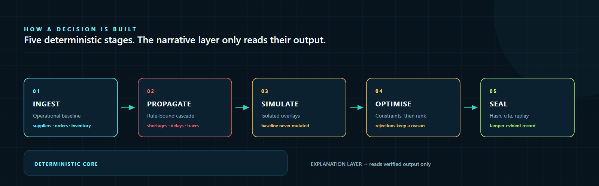
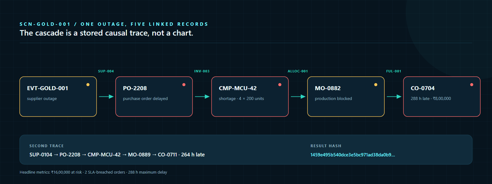
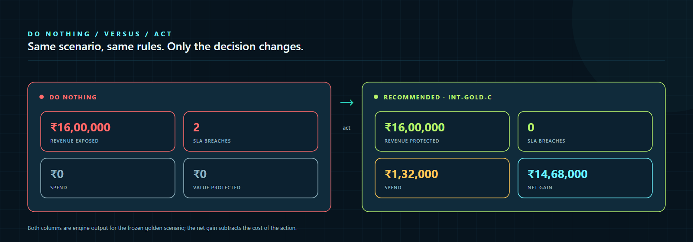
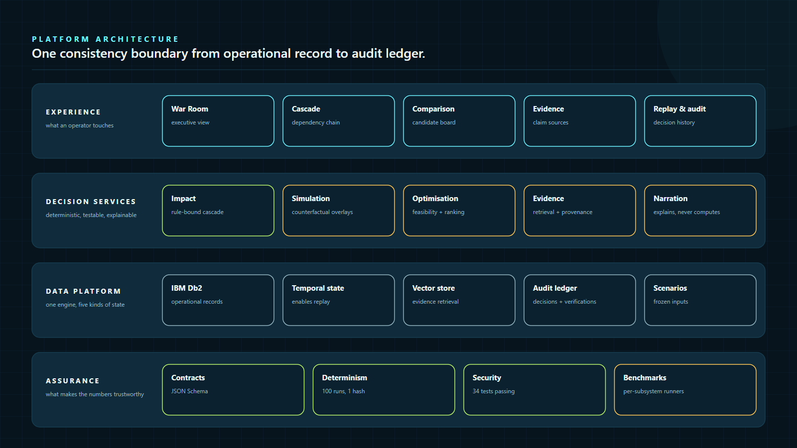
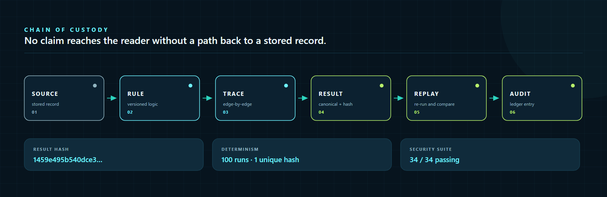

# ChronosDB

### Decision intelligence for supply-chain disruptions, designed around IBM Db2.

When a supplier fails, most systems report the damage. ChronosDB shows what breaks next,
compares the recovery paths, recommends one under hard constraints — and hands you the
proof for every number it used.

[Overview](#overview) · [Features](#features) · [How it works](#how-it-works) · [Results](#results-on-the-golden-scenario) · [Platform](#platform) · [Status](#project-status)

---

---

## Overview

Supply chains fail in cascades, but operations teams are handed flat dashboards. Someone
notices an outage, a spreadsheet gets built, three people guess at the best recovery, and
nobody can explain afterwards why the chosen plan was chosen.

ChronosDB closes that loop. It reconstructs how an outage travels from a supplier into
customer commitments, tests every credible recovery against a copy of operational state,
ranks what survives the real constraints, and attaches the causal trail and evidence
references to the recommendation.

The design rule is simple: **arithmetic is deterministic, and the narrative layer may
only explain what it was given.** No recommendation is generated prose.

## Features

**Deterministic impact propagation** — a disruption is traced edge by edge through the
bill of materials, inventory and fulfilment rules, so impact can be walked backwards as
well as forwards.

**Counterfactual recovery simulation** — candidates run against an isolated overlay of
operational state, so the live baseline is never mutated and "what if" is safe to ask.

**Constraint-aware optimisation** — supplier capacity and safety-stock floors filter
candidates before ranking. Rejected plans keep the reason they were rejected.

**Evidence-bound explanation** — every claim carries a document reference; unsupported
statements are refused rather than softened.

**Tamper-evident results** — each decision is canonicalised and hashed, so a changed
figure stops matching the record.

**Replayable decisions** — past decisions are re-executed from stored state and compared,
instead of being trusted on the strength of a screenshot.

## How it works

A scenario starts as operational records. The disruption resolves into concrete shortages
and delays, each attributed to a named rule. Candidates are simulated in isolation,
infeasible ones are dropped with a reason, and the survivor is ranked against a declared
objective — such as minimising SLA breaches within budget — before being hashed, cited
and sealed for replay.

## Results on the golden scenario

One frozen scenario underpins the product, the benchmarks and the documentation, so no
two artefacts can quietly disagree.

| Measure | Result |
|---|---|
| Revenue at risk if nothing is done | **₹16,00,000** |
| Customer orders missing their promise date | **2** |
| Recovery candidates evaluated | **7** — five feasible, two rejected by hard constraints |
| Recommended action | **INT-GOLD-C** — the only candidate that clears every constraint *and* removes all breaches |
| Cost of the recommendation | **₹1,32,000** |
| Revenue protected / net gain | **₹16,00,000** / **₹14,68,000** |
| SLA breaches remaining | **0** |
| Reproducibility | **100 repeated runs, one identical result hash** |

The two rejections matter as much as the recommendation: one cannot work because the
primary supplier is entirely unavailable, another would breach a safety-stock floor. A
system that can only say yes is not a decision system.

## Platform

ChronosDB is built on the view that a decision system should not have to reconcile four
databases after the fact. Db2 holds operational records, the temporal state that makes
replay possible, the embeddings behind evidence retrieval, the audit ledger, and scenario
inputs — one consistency boundary instead of four. The trade-offs are in the Db2 deep dive.

## Trust and auditability

- **Contracts before content** — request, result and narration shapes are fixed by schema.
- **Hash-checked records** — the hash derives from the result body, so the record proves
  its own integrity.
- **Measured determinism** — one hundred repeated runs collapse to a single hash.
- **Adversarial testing** — injection, authorisation, SQL and replay integrity: 34 of 34
  security tests pass.

## Project status

A release candidate, and honest about it.

- **Solid** — deterministic impact engine, contracts, golden scenario, security suite,
  reproducibility evidence.
- **In progress** — the HTTP service and the one-command demo. A configuration name
  collision stops the service starting, and some container build inputs are not yet in
  the repository.
- **Design stage** — the Db2 deployment path; no Db2 runtime was available during
  verification.
- **Not re-measured** — retrieval quality and load behaviour. Earlier figures for these
  were withdrawn rather than repeated.

Nothing here quotes a number the engine cannot currently reproduce.

## Limitations

- Not deployable end to end yet: service layer and container packaging are unfinished.
- Database integration is validated by design review, not a running instance.
- Dashboard imagery in the brand pack is design work; the diagrams above are generated
  directly from engine output.
- Retrieval, concurrency and recovery behaviour still need trustworthy numbers.
- The bundled local development credentials must never be reused outside a laptop.

## Documentation

| Document | What it covers |
|---|---|
| [Architecture](docs/architecture/architecture.md) | Components, data flow and responsibilities |
| [Golden scenario](docs/demo/verified-golden-figures.md) | The frozen scenario and every verified figure |
| [Db2 deep dive](docs/db2-deep-dive.md) | Why Db2, what it stores, how it is used |
| [Threat model](docs/threat-model.md) | Assets, threats and controls |
| [Benchmark design](docs/benchmark-results.md) | How each subsystem is measured |
| [Release review](docs/release/go-no-go.md) | Open defects, go/no-go decision and scorecard |
| [Limitations](docs/limitations.md) | What ChronosDB deliberately does not do |
| [Data dictionary](docs/data-dictionary.md) | Entities, fields and relationships |

## Contributing

Review and critique are welcome, especially on the parts marked in progress or unproven.
Reproducible counter-examples are more useful than opinions.

## License

MIT. See the license file for details.

ChronosDB · auditable decision intelligence for supply-chain disruptions Every figure published here is generated from the engine, never typed by hand.

