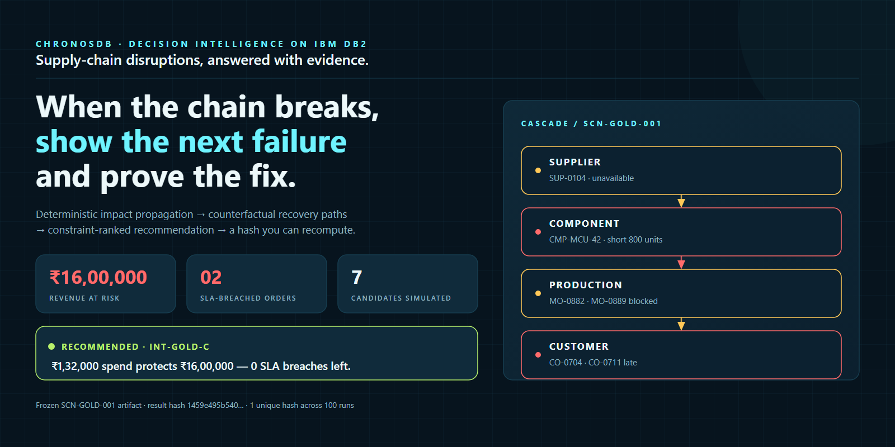

# ChronosDB

### Decision intelligence for supply-chain disruptions, designed around IBM Db2.

When a supplier fails, most systems report the damage. ChronosDB shows what breaks next,
compares the recovery paths, recommends one under hard constraints — and hands you the
proof for every number it used.

[Overview](#overview) · [Features](#features) · [How it works](#how-it-works) · [Results](#results-on-the-golden-scenario) · [Status](#project-status) · [Documentation](#documentation)

---

---

## Overview

Supply chains fail in cascades, but operations teams are handed flat dashboards. The
result is a familiar loop: someone notices an outage, a spreadsheet gets built, three
people guess at the best recovery, and nobody can explain afterwards why the chosen
plan was chosen.

ChronosDB closes that loop. It reconstructs how an outage travels from a supplier
through purchase orders, components and production into customer commitments. It then
tests every credible recovery against a copy of the operational state, ranks what
survives the real constraints, and attaches the causal trail and evidence references
to the recommendation.

The design principle is simple: **arithmetic is deterministic, and the narrative layer
may only explain what it was given.** Nothing in the recommendation is generated prose.
The language model is a translator of verified facts, not a source of them.

## Features

**Deterministic impact propagation**
A disruption is traced edge by edge through the bill of materials, inventory
projection and fulfilment rules. Every hop is a named rule with a recorded causal
trace, so an impact can be walked backwards as well as forwards.

**Counterfactual recovery simulation**
Each candidate action runs against an isolated overlay of operational state. The live
baseline is never mutated, which makes "what if" genuinely safe to ask.

**Constraint-aware optimisation**
Candidates are filtered by hard constraints — supplier capacity, safety-stock floors —
before they are ranked against a declared objective. Infeasible plans are reported with
the reason they were rejected, not silently dropped.

**Evidence-bound explanations**
Every claim in the narrative carries a document reference from the evidence layer.
Claims that cannot be sourced are refused rather than softened.

**Tamper-evident results**
Each decision is serialised into a canonical result and hashed. Edit a single figure and
the hash no longer matches, which makes the record auditable long after the incident.

**Replayable decisions**
A past decision can be re-executed from stored state and compared with what was
originally produced, rather than trusted on the strength of a screenshot.

**Security treated as a feature**
Prompt-injection attempts, SQL manipulation, unauthorised writes and replay tampering
are covered by a dedicated security suite that passes in full.

**One engine for operational, temporal, vector and audit data**
Db2 holds the operational records, the historical state needed for replay, the
embeddings used for evidence retrieval, and the audit ledger — one consistency
boundary instead of four.

## How it works

1. **Ingest** — operational records (suppliers, orders, inventory, production) form the
   baseline state for a scenario.
2. **Propagate** — a disruption is resolved into concrete shortages and delays, each
   attributed to a rule and a source record.
3. **Simulate** — every candidate recovery is evaluated in isolation against that baseline.
4. **Optimise** — infeasible candidates are rejected with a reason; the rest are ranked
   against the objective, such as minimising SLA breaches within budget.
5. **Explain and seal** — the chosen action is narrated from verified inputs, evidence
   references are attached, and the result is hashed for audit and replay.

The War Room experience sits on top of that pipeline: an executive view, the dependency
cascade, a side-by-side comparison of candidates, the evidence behind each claim, the
replay of a past decision, and the audit ledger.

## Results on the golden scenario

One frozen scenario, used consistently across the product, benchmarks and documentation,
so that no two artefacts can quietly disagree.

A single supplier goes unavailable. The shortage propagates to two production orders and
two customer commitments. Seven recovery options are evaluated.

| Measure | Result |
|---|---|
| Revenue at risk if nothing is done | **₹16,00,000** |
| Customer orders that miss their promise date | **2** |
| Recovery candidates evaluated | **7** — five feasible, two rejected by hard constraints |
| Recommended action | **INT-GOLD-C** — the only candidate that clears every hard constraint *and* removes all SLA breaches |
| Cost of the recommendation | **₹1,32,000** |
| Revenue protected / net gain | **₹16,00,000** / **₹14,68,000** |
| SLA breaches remaining after the action | **0** |
| Reproducibility | **100 repeated runs collapse to one identical result hash** |

The two rejections are as informative as the recommendation: one candidate cannot work
because the primary supplier is entirely unavailable, and another would violate a
safety-stock floor. A system that can only say yes is not a decision system.

## Trust and auditability

- **Schema-governed contracts.** Request, result and narration shapes are fixed by formal
  JSON Schema contracts, and the golden result validates cleanly against its schema.
- **Recomputable hashes.** The recorded hash is derived from the result body itself, so
  the record proves its own integrity.
- **Measured determinism.** The determinism report holds one hundred repeated runs with a
  single unique hash.
- **Citable claims only.** The narrative layer refuses assertions it cannot trace to a
  stored reference; unsupported numbers are not presented as findings.
- **Adversarial testing.** The security suite — injection, authorisation, SQL and replay
  integrity — passes 34 of 34.

## Built on IBM Db2

ChronosDB is designed around the idea that a decision system should not have to
reconcile four databases after the fact. Db2 holds operational records, temporal state
for replay, vector embeddings for evidence retrieval, the audit ledger, and scenario and
simulation records in one engine. The rationale, trade-offs and storage design are
documented in the deep dive.

## Project status

ChronosDB is a **release candidate**. It is honest about where it stands:

- **Solid today** — the deterministic impact engine, its contracts, the golden scenario,
  the security suite and the reproducibility evidence.
- **In progress** — the HTTP service and the packaged one-command demo. A name collision
  in configuration currently prevents the service from starting, and some container
  build inputs are not yet in the repository.
- **Design stage** — the Db2 deployment path. No Db2 runtime was available during
  verification, so the database integration is documented as a design target rather than
  demonstrated.
- **Not yet re-measured** — retrieval quality and load behaviour. Earlier figures for
  these were withdrawn rather than repeated.

The full picture, including open defects, sits in the release documentation. Nothing in
this README quotes a figure that the engine cannot currently reproduce.

## Limitations

- Not yet deployable end to end: the service layer and container packaging are unfinished.
- The database integration is validated by design review, not by a running instance.
- The dashboard imagery in the brand pack is design work, not a capture of a live system.
  The diagrams in this README are generated directly from engine output.
- Retrieval quality, concurrency and recovery behaviour still need trustworthy numbers.

## Documentation

| Document | What it covers |
|---|---|
| [Architecture](docs/architecture/architecture.md) | Components, data flow and responsibilities |
| [Golden scenario](docs/demo/verified-golden-figures.md) | The frozen scenario and every verified figure |
| [Db2 deep dive](docs/db2-deep-dive.md) | Why Db2, what it stores, how it is used |
| [Threat model](docs/threat-model.md) | Assets, threats and controls |
| [Benchmark design](docs/benchmark-results.md) | How each subsystem is measured |
| [Release review](docs/release/go-no-go.md) | Open defects, go/no-go decision and scorecard |
| [Limitations](docs/limitations.md) | What ChronosDB deliberately does not do |
| [Data dictionary](docs/data-dictionary.md) | Entities, fields and relationships |

## Contributing

The project welcomes review and critique, especially on the parts listed as in progress or
unproven. Reproducible counter-examples are more useful than opinions.

## License

MIT. See the license file for details.

ChronosDB · auditable decision intelligence for supply-chain disruptions Every figure published here is generated from the engine, never typed by hand.

