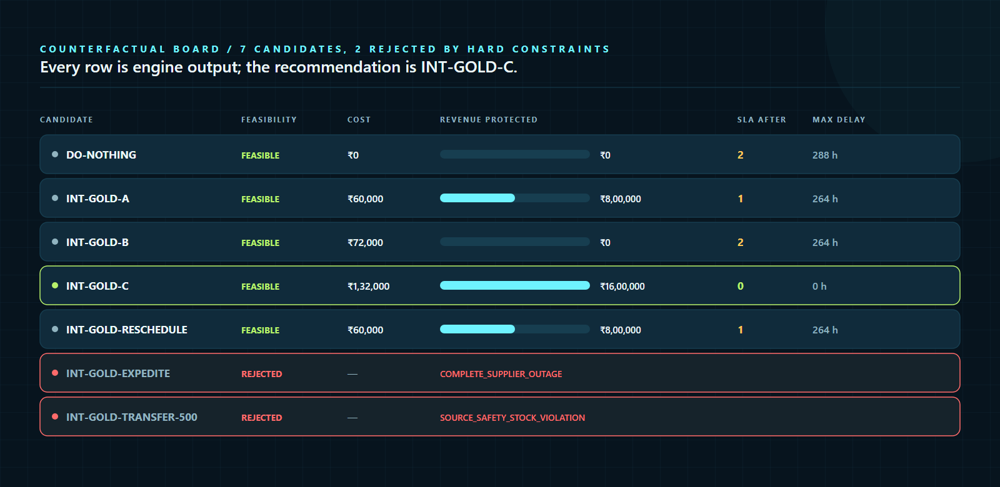
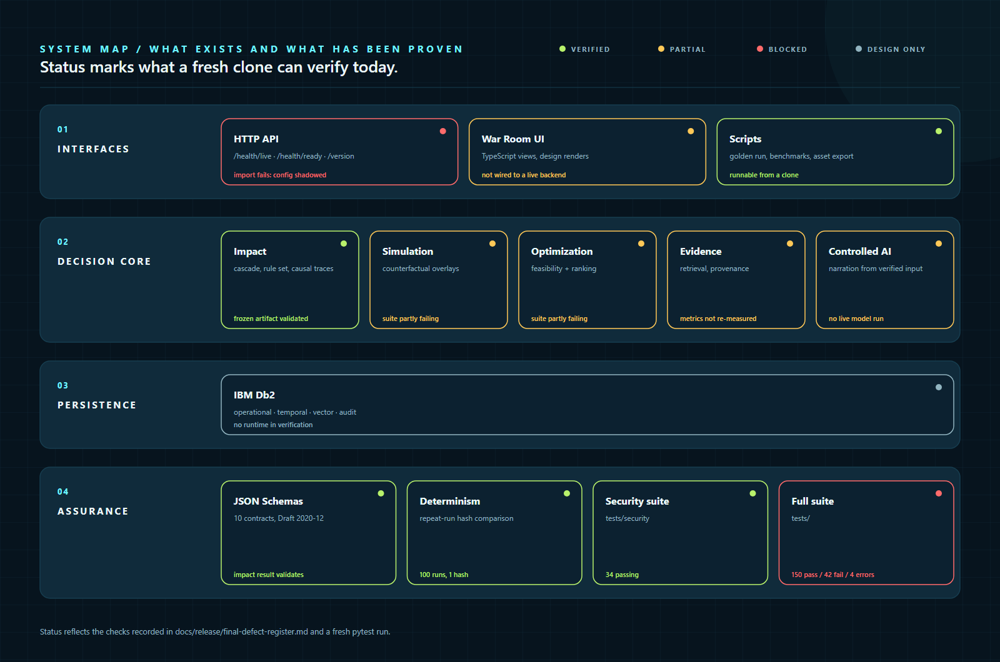
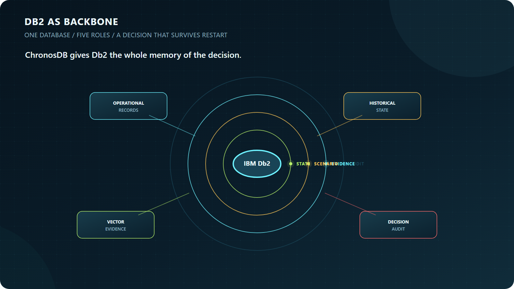

<div align="center">


# ChronosDB

### When a supplier fails, show the next failure — then prove the fix.

A deterministic decision engine for supply-chain disruptions: propagate the impact,
simulate the recovery options, rank them under hard constraints, and keep every
number attached to a stored record and a recomputable hash.

[](LICENSE)
[](pyproject.toml)
[](docs/db2-deep-dive.md)
[](#verify-it-yourself)
[](#verify-it-yourself)
[](docs/release/go-no-go.md)

[Architecture](#architecture) · [Golden scenario](#the-golden-scenario-scn-gold-001) · [Status](#status-what-works-today) · [Verify it yourself](#verify-it-yourself) · [Docs](#documentation)

</div>

---


<div align="center"><sub>Every figure in this image is read from <code>artifacts/phase-5/golden-impact-result.json</code> at build time — regenerate with <code>python scripts/generate_readme_assets.py</code>.</sub></div>

---

## The question this project answers

Dashboards tell you that something broke. ChronosDB is built around the next four
questions, and it answers each one with code rather than prose.

| Question | How ChronosDB answers it | Where it lives |
|---|---|---|
| **What happened?** | A supplier outage is traced through purchase orders, components, production orders and customer lines as an explicit causal trace, edge by edge. | `src/chronosdb/impact/causality/` |
| **What happens next?** | Every candidate recovery is replayed against an isolated copy of the operational state, so the baseline is never mutated. | `src/chronosdb/simulation/` |
| **What should we do?** | Candidates are filtered by hard constraints (supplier capacity, safety stock) and ranked against a declared objective. | `src/backend/chronosdb/optimization/` |
| **Why should anyone believe it?** | Numbers come from deterministic Python, each claim cites a document reference, and the result carries a canonical hash you can recompute. | `schemas/`, `artifacts/`, `src/backend/chronosdb/ai/claim_verifier.py` |

The AI layer is deliberately narrow: it narrates results it is handed and refuses
claims it cannot cite. It does not compute, rank, or invent.

## The golden scenario (SCN-GOLD-001)

One frozen scenario, used everywhere in this repository, so that no screenshot and
no document can quietly disagree with the engine.

Supplier **SUP-0104** goes unavailable → component **CMP-MCU-42** shorts by 800 units
across 4 records → production orders **MO-0882** and **MO-0889** block → customer
orders **CO-0704** and **CO-0711** miss their promise dates.


| Measure | Value | Source |
|---|---|---|
| Revenue at risk (do nothing) | **₹16,00,000** | `golden-impact-result.json → headline_metrics.revenue_at_risk` |
| SLA-breached customer orders | **2** (CO-0704, CO-0711) | `headline_metrics.sla_breached_customer_order_count` |
| Maximum delay | **288 h** | `headline_metrics.maximum_delay_hours` |
| Shortage | **800 units** on CMP-MCU-42 (4 records × 200) | `shortages[]` |
| Candidates evaluated | **7** — 5 feasible, 2 rejected by hard constraints | `expected_candidate_results.json` |
| Recommended | **INT-GOLD-C** | `data/golden/expected_recommendation.json` |
| Cost of recommended action | **₹1,32,000** | candidate row `intervention_cost` |
| Revenue protected / net | **₹16,00,000** / **₹14,68,000** | candidate row, recommendation |
| SLA breaches after the action | **0** | candidate row `sla_breach_count` |
| Determinism | **100 runs, 1 unique hash** | `determinism-report.json` |



The two rejections matter as much as the recommendation: `INT-GOLD-EXPEDITE` is
rejected with `COMPLETE_SUPPLIER_OUTAGE` and `INT-GOLD-TRANSFER-500` with
`SOURCE_SAFETY_STOCK_VIOLATION`. A system that can only say "yes" is not a decision
system.

### Why the numbers are checkable

- The impact result is validated against `schemas/impact-result.schema.json`
  (JSON Schema Draft 2020-12) — currently **0 validation errors**.
- `result_hash` is the canonical hash of the result body **minus** `result_hash`
  itself, so any edit breaks the hash: `1459e495b540…`.
- The determinism report stores 100 repeated runs, all hashing to the same value.
- Every quotable figure is listed with its source in
  [`docs/demo/verified-golden-figures.md`](docs/demo/verified-golden-figures.md).

Anything not in that document is treated as unverified in this README — including
some numbers that older documentation in this repo still shows. See
[Claims that were withdrawn](#claims-that-were-withdrawn).

## Architecture



| Layer | Path | Responsibility | Proven here? |
|---|---|---|---|
| Impact engine | `src/chronosdb/impact/` | Cascade, rule set, causal traces, shortage records | ✅ Frozen artifact validates; hash recomputes |
| Simulation | `src/chronosdb/simulation/` | Counterfactual overlays on copied state | ⚠️ Suite partly failing |
| Optimization | `src/backend/chronosdb/optimization/` | Feasibility filters, constraint ranking | ⚠️ Suite partly failing |
| Evidence | `src/backend/chronosdb/evidence/` | Retrieval, provenance, claim references | ⚠️ Retrieval metrics not re-measured |
| Controlled AI | `src/backend/chronosdb/ai/` | Narration restricted to supplied facts | ⚠️ No live model run recorded |
| Audit & replay | `src/backend/chronosdb/audit/replay/` | Decision replay and verification | ⚠️ Replay test broken (D-01) |
| HTTP API | `src/chronosdb/api.py` | `/health/live`, `/health/ready`, `/version` | ❌ Import fails (see below) |
| War Room UI | `src/frontend/` | TypeScript views, layout, services | ⚠️ Not wired to a live backend |
| Contracts | `schemas/` (10 JSON Schemas) | Request/result/narration contracts | ✅ Impact result validates |
| Benchmarks | `benchmark/runners/` | One runner per subsystem | ⚠️ Results depend on the failing suites |
| Reproducibility | `Makefile`, `docker-compose.yml`, `scripts/` | Setup, Db2, seeding, demo, assets | ❌ `make setup` fails (D-02) |

234 Python files under `src/`, 42 pytest modules across 33 test directories, and 16
TypeScript files under `src/frontend/`.

Full design: [`docs/architecture/architecture.md`](docs/architecture/architecture.md) ·
Data model: [`docs/data-dictionary.md`](docs/data-dictionary.md)

## Status: what works today

ChronosDB is a **release candidate that did not pass its own release gate.**
An independent review (Phase 19) returned **NO-GO**, with 7 open severity-1 defects
recorded in [`docs/release/final-defect-register.md`](docs/release/final-defect-register.md).

This section is the honest split, because a README that hides this is worth less
than one that states it.

**Verified in this working tree**

- Golden impact artifact: schema-valid, hash recomputes, 100/100 identical runs.
- `tests/security/` — **34 passed** (prompt-injection, SQL, unauthorized write, replay integrity).
- 10 JSON Schema contracts; the impact result validates against its schema.
- 150 of 192 collected tests pass. Fully green suites include `tests/security/`,
  `tests/privacy/`, `tests/procurement/`, `tests/simulation/`, `tests/evidence/`
  and `tests/release/`.

**Broken or unproven**

| # | Blocker | Severity |
|---|---|---|
| D-01 | Golden re-run script references a missing fixture (`expected_engine_causal_traces.json`); replay test fails | S1 |
| D-02 | `make setup` fails — `docker/frontend` is absent from the repository, and `docker-compose.yml` builds `./docker/backend`, which is also absent | S1 |
| D-03 | Demo video never rendered | S1 |
| D-04 | Submission artifacts (PR, form, participant identity) missing | S1 |
| D-05 | Full suite: **150 passed, 42 failed, 4 collection errors** | S1 |
| D-06 | `chronosdb.config` is shadowed by the `config/` package, so `chronosdb.config.Settings` cannot be imported and the API cannot start | S1 |
| D-07 | Several tests call undefined helpers (`validate_schema`, `project_inventory`, …) | S1 |
| D-09 | Retrieval metrics (Recall@5, MRR) not re-measured | S2 |
| D-14 | Older phase reports contain results that do not reproduce today | S2 |

Db2 was not available to the verification pass, so the Db2 integration path is a
**design target, not a demonstrated run** — see [`docs/release/db2-review.md`](docs/release/db2-review.md).

## Quick start

> **Reality check:** `make setup` and `docker compose up` cannot complete on a fresh
> clone until `docker/` exists in the repository (D-02). The commands that *do* work
> today are the Python-side ones below.

```bash
git clone https://github.com/bhuwanb23/chronosdb.git
cd chronosdb
python -m venv .venv && source .venv/Scripts/activate   # Windows: .venv\Scripts\activate
pip install -e ".[dev]"                                  # fastapi, ibm-db, jsonschema, pytest, ruff, mypy
cp .env.example .env                                     # local values only; never commit .env
```

Working commands:

```bash
python -m pytest tests/security -q          # 34 passed
python -m pytest -q --continue-on-collection-errors   # full picture, 150 pass / 42 fail
python scripts/generate_readme_assets.py    # rebuild every image in this README
python scripts/generate_assets.py           # rebuild the brand asset pack
```

Intended (not yet working) lifecycle:

| Command | Purpose | Today |
|---|---|---|
| `make setup` | Install Python + frontend dependencies | ❌ missing `docker/frontend` |
| `make db-up` | Start Db2 11.5.9 via `docker-compose.yml` | ⚠️ untested here |
| `make migrate` / `make seed` | Schema and golden seed data | ⚠️ depends on Db2 |
| `make embeddings` | Build evidence embeddings | ⚠️ depends on Db2 |
| `make demo` | Full golden-scenario startup | ❌ blocked by the above |

## Verify it yourself

Three checks that need no database, no Docker and no network:

```bash
# 1. Security suite
python -m pytest tests/security -q
# => 34 passed

# 2. Golden artifact: schema-valid and tamper-evident
PYTHONPATH=src python - <<'PY'
import json
from jsonschema import Draft202012Validator, FormatChecker
from chronosdb.impact.contracts.results import canonical_hash

result = json.load(open("artifacts/phase-5/golden-impact-result.json"))
schema = json.load(open("schemas/impact-result.schema.json"))
errors = list(Draft202012Validator(schema, format_checker=FormatChecker()).iter_errors(result))
assert not errors, errors[:1]
body = {k: v for k, v in result.items() if k != "result_hash"}
assert canonical_hash(body) == result["result_hash"]
print("golden artifact: schema valid, hash recomputes")
PY

# 3. Determinism: repeat runs collapse to one hash
python -c "import json;r=json.load(open('artifacts/phase-5-handoff/determinism-report.json'));\
print(len(r['repeated_result_hashes']), 'runs,', len(set(r['repeated_result_hashes'])), 'unique hash')"
# => 100 runs, 1 unique hash
```

## Why Db2

The design puts five kinds of state in one engine rather than five systems:
operational records, temporal state for replay, vector embeddings for evidence
retrieval, the audit ledger, and simulation/scenario records. The argument for that
consolidation — and what it costs — is in
[`docs/db2-deep-dive.md`](docs/db2-deep-dive.md).



**Not proven:** no Db2 runtime was available to the verification pass, and the Db2
integration test does not import. Treat the schema in `src/chronosdb/sql/` as a
design artifact until it runs.

## Claims that were withdrawn

This repository previously published numbers that were never produced by the engine
(typed into mockups and phase reports), including ₹18.4L revenue at risk, 3 SLA
breaches, 71% risk protected, 0.86 decision confidence, Recall@5 = 0.87, MRR = 0.82,
and "100% prompt-injection blocked". They are listed as unverified in
[`docs/demo/verified-golden-figures.md`](docs/demo/verified-golden-figures.md) and are
not used here.

That document and the frozen artifacts are the only sources this README quotes.
Where this README could not verify a claim, it says so instead of dropping the claim
quietly.

## Repository layout

```
src/chronosdb/            impact engine, simulation, API entry point, SQL, config
src/backend/chronosdb/    evidence, optimization, AI, audit/replay, middleware, routers
src/frontend/             TypeScript War Room views, services, theme, e2e config
schemas/                  10 JSON Schema contracts (Draft 2020-12)
data/golden/              frozen scenario, interventions, expected results
data/releases/v1.0.0/     released dataset + golden candidate results
artifacts/                frozen engine output: impact result, determinism report
scripts/                  data generation, validation, asset generation, golden run
benchmark/runners/        one benchmark runner per subsystem
tests/                    42 pytest modules across 33 directories
docs/                     architecture, Db2, threats, release gate, demo, evidence
assets/                   brand pack (assets/chronosdb) and README diagrams (assets/readme)
```

## Documentation

| Document | Why read it |
|---|---|
| [Architecture](docs/architecture/architecture.md) | Components, data flow, responsibilities |
| [Verified figures](docs/demo/verified-golden-figures.md) | Every quotable number and its source |
| [Defect register](docs/release/final-defect-register.md) | What is broken, with evidence |
| [Go / no-go](docs/release/go-no-go.md) | Current release decision |
| [Threat model](docs/threat-model.md) | Assets, threats, controls |
| [Db2 deep dive](docs/db2-deep-dive.md) | Why Db2, what it stores |
| [Benchmark design](docs/benchmark-results.md) | Benchmark structure (see caveat above) |
| [Limitations](docs/limitations.md) | What ChronosDB does not do |
| [Data dictionary](docs/data-dictionary.md) | Entities and fields |
| [Decision log](docs/decision-log.md) | Why key choices were made |
| [Traceability matrix](docs/traceability-matrix.csv) | Requirements → evidence |
| [Demo script](docs/demo/final-script.md) | The 2:45 walkthrough |

## Limitations

- The release gate is **NO-GO**; 7 severity-1 defects are open.
- The HTTP API cannot be imported (`chronosdb.config` name collision), so nothing
  end-to-end can be demonstrated against a live service yet.
- No Db2 runtime was exercised during verification.
- The War Room images in `assets/` are **design renders**, not captures of a running
  system. `assets/readme/*` is generated from engine artifacts and carries only
  verified values.
- `docker-compose.yml` ships local development passwords. Do not reuse them
  anywhere; move to `.env` / secrets before any deployment.
- Retrieval quality, load behaviour and recovery behaviour lack trustworthy
  measurements today.

## License

MIT — see [LICENSE](LICENSE).

<div align="center"><sub>Repository: <a href="https://github.com/bhuwanb23/chronosdb">github.com/bhuwanb23/chronosdb</a> · Diagrams generated from <code>artifacts/</code>, never hand-typed.</sub></div>
